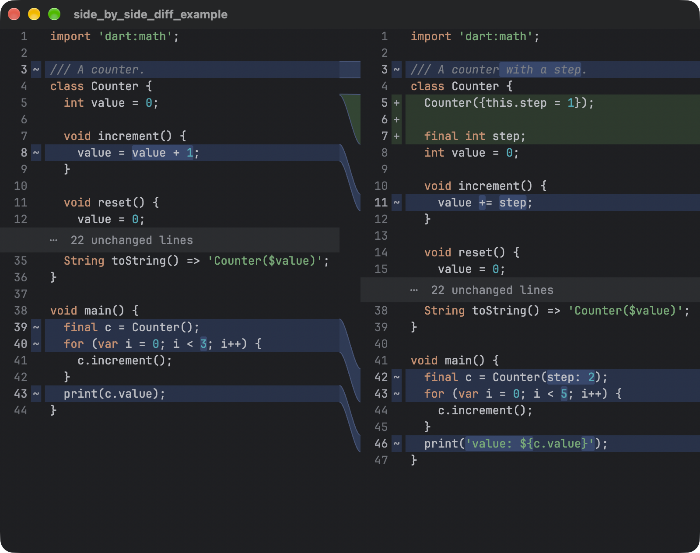

# side_by_side_diff

A fast side-by-side diff view for Flutter, modelled on the JetBrains IDEs' diff viewer.



- Two synced panes with curved ribbons linking each change across the divider.
- Word-level highlights inside changed lines, plus your own syntax colors.
- Nested folding of unchanged regions ("… N unchanged lines").
- Line selection in the gutter (drag, Shift-click, Shift+arrows) with copy.
- Inlays: put any widget between lines (review comments, notes) without the view jumping.
- Self-painted rows with cached paragraphs, built for large files: on a 20,000-line diff, scrolling costs about 3 ms per frame (p95) on an M3 Pro.
- Rows can be paged in from a backend, or kept in memory.

It depends only on Flutter. Desktop is the main target; it works wherever Flutter runs.

## Usage

```dart
import 'package:side_by_side_diff/side_by_side_diff.dart';

final diff = TextDiff.compute(oldText, newText, path: 'main.dart');

final theme = DiffThemeData.dark();
final controller = DiffViewController(
  document: diff.document,
  lines: diff.lines,
  theme: theme,
  devicePixelRatio: MediaQuery.devicePixelRatioOf(context),
);

SideBySideDiff(
  controller: controller,
  theme: theme,
  inlayBuilder: (context, spec) => const SizedBox.shrink(),
);
```

Dispose the controller when the view closes. See [`example/`](example/) for a complete app.

## Syntax highlighting

Pass `syntax:` to `TextDiff.compute`. It returns `(start, length, captureId)` triples for each line, where `captureId` indexes the `captureNames` you give the controller (for example `['', 'keyword', 'string']`). `DiffThemeData.syntax` maps capture names to colors, and a dotted name such as `keyword.control` falls back to `keyword`. Any tokenizer works; the example uses a small regex.

## Your own diff or backend

`TextDiff` is a plain line diff (Myers) with a word diff inside changed lines. To use a different algorithm, or to page rows in from a server, build a `DiffDocument` (blocks and unchanged gaps) yourself and implement `DiffLineSource`; `MemoryLineSource` is the in-memory one.

## Fonts

The default theme asks for `JetBrains Mono` and falls back to Menlo and the platform's monospace font. The package doesn't bundle a font; add one to your app, as the example does, or set `fontFamily` on the theme.

## Limits

- Side by side only; there's no unified (single-column) mode yet.
- No screen-reader semantics for rows yet.
- `TextDiff` keeps memory proportional to the number of differences times the file length, so a large file that's completely rewritten is slow to diff.

## License

MIT. The example bundles JetBrains Mono under the SIL Open Font License.
