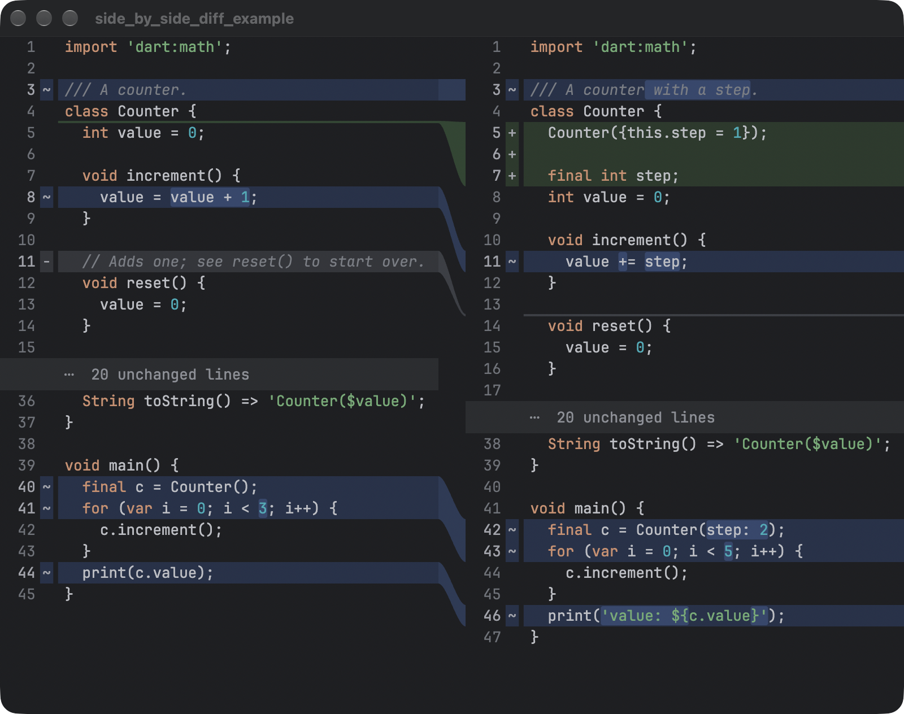

# diff_view

A fast side-by-side and unified diff view for Flutter, modelled on the JetBrains IDEs' diff viewer.



- Two synced panes with curved ribbons linking each change across the divider.
- A unified (single-column) view of the same controller, for when one column reads better, such as a new file.
- Word-level highlights inside changed lines, plus your own syntax colors.
- Nested folding of unchanged regions ("… N unchanged lines").
- Text selection in the code with the mouse (drag, double and triple click, Shift-click) with copy, as in an editor.
- Line selection in the gutter (drag, Shift-click, Shift+arrows) with copy.
- Inlays: put any widget between lines (review comments, notes) without the view jumping.
- Self-painted rows with cached paragraphs, built for large files: on a 20,000-line diff, scrolling costs about 3 ms per frame (p95) on an M3 Pro.
- Rows can be paged in from a backend, or kept in memory.

It depends only on Flutter. Desktop is the main target; it works wherever Flutter runs.

## Usage

```dart
import 'package:diff_view/diff_view.dart';

final diff = TextDiff.compute(oldText, newText, path: 'main.dart');

final theme = DiffThemeData.dark();
final controller = DiffViewController(
  document: diff.document,
  lines: diff.lines,
  theme: theme,
  devicePixelRatio: MediaQuery.devicePixelRatioOf(context),
);

SideBySideDiff(
  controller: controller,
  theme: theme,
  inlayBuilder: (context, spec) => const SizedBox.shrink(),
);
```

Dispose the controller when the view closes. See [`example/`](example/) for a complete app.

## Unified view

`UnifiedDiff` shows the same controller in one column, like GitHub's or JetBrains' unified viewer:

```dart
UnifiedDiff(
  controller: controller,
  theme: theme,
  inlayBuilder: (context, spec) => const SizedBox.shrink(),
);
```

- The gutter has the old and new line numbers and a `+` or `−` marker. Unchanged lines appear once; each change shows its deleted lines, then its inserted lines, with word highlights. An added file is all `+` rows.
- Folds, inlays, the theme and the paragraph cache are shared with `SideBySideDiff`, so you can switch between the two without rebuilding anything. The new view opens at the line the old one showed.
- An inlay of either side is drawn below the row of its line.
- `jumpToLine`, `viewportYOfLine` and `ensureLineVisible` act on whichever view is laid out.
- The gutter selection is `controller.unifiedSelection`, in rows. `controller.unifiedRows.linesIn(span)` gives the old and new lines it covers, and copy takes the shown text without markers.

## Selecting and copying

- Drag in the code to select text in one pane, or across the rows of the unified view as shown. Double click selects a word, triple click a line, Shift-click extends, and a click elsewhere in the view or Escape clears it. Dragging past the top or bottom edge scrolls.
- Cmd/Ctrl+C copies the text as shown, each line followed by its own line end, without `+`/`-` markers or line numbers. Folded lines are left out; lines your `DiffLineSource` hasn't loaded are loaded for the copy.
- A drag in the gutter still selects whole lines. There is one selection at a time, and `controller.copySelection()` copies whichever there is.
- `controller.textSelection` is a `ValueListenable<CodeSelection?>` with the side (null in the unified view, where lines are rows), start and end as line and column, so you can show your own menu or handle keys yourself; `controller.textOf(selection)` gives its text and `controller.clearTextSelection()` clears it. `selectionChanges` fires for it too.
- `DiffThemeData.textSelection` is its colour. To select only lines, pass `textSelectionEnabled: false` to the controller.

## Syntax highlighting

Pass `syntax:` to `TextDiff.compute`. It returns `(start, length, captureId)` triples for each line, where `captureId` indexes the `captureNames` you give the controller (for example `['', 'keyword', 'string']`). `DiffThemeData.syntax` maps capture names to colors, and a dotted name such as `keyword.control` falls back to `keyword`. Any tokenizer works; the example uses a small regex.

## Your own diff or backend

`TextDiff` is a plain line diff (Myers) with a word diff inside changed lines. To use a different algorithm, or to page rows in from a server, build a `DiffDocument` (blocks and unchanged gaps) yourself and implement `DiffLineSource`; `MemoryLineSource` is the in-memory one.

## Fonts

The default theme asks for `JetBrains Mono` and falls back to Menlo and the platform's monospace font. The package doesn't bundle a font; add one to your app, as the example does, or set `fontFamily` on the theme.

## Limits

- No screen-reader semantics for rows yet.
- `TextDiff` keeps memory proportional to the number of differences times the file length, so a large file that's completely rewritten is slow to diff.

## License

MIT. The example bundles JetBrains Mono under the SIL Open Font License.
